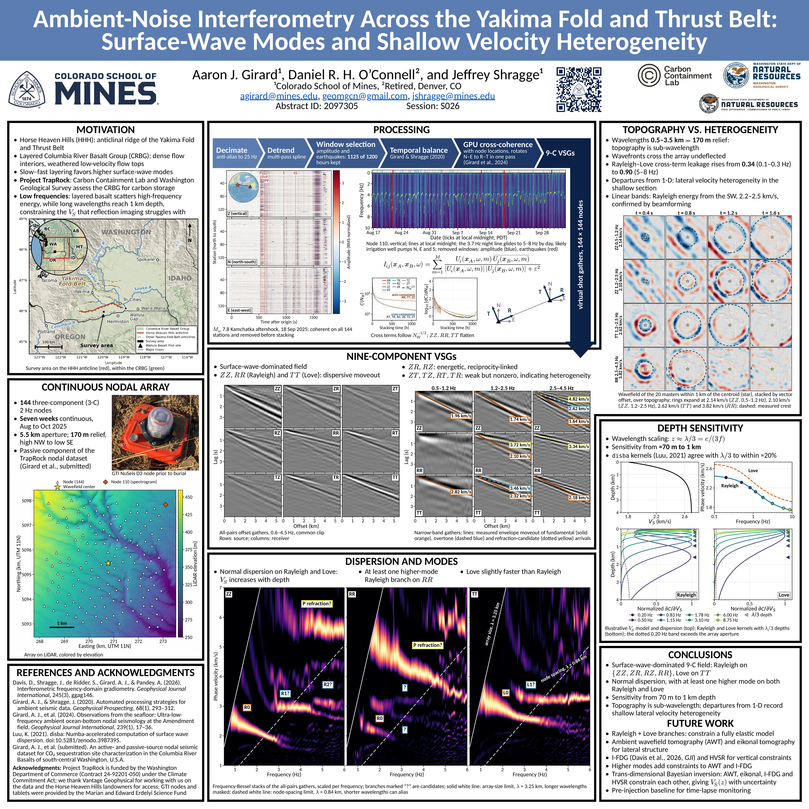

**Aaron J. Girard**^1^, Daniel R. H. O'Connell^2^ and Jeffrey Shragge^1^
^1^Colorado School of Mines, ^2^Retired, Denver, CO

AGU Fall Meeting 2026 · Session S026, Passive Seismic Monitoring of Spatiotemporal Earth Processes · Abstract 2097305

Thanks for scanning. Everything from the poster is here to take with you.

[Download the poster (PDF, 31 MB)](files/agu26/Girard_AGU26_poster.pdf){.btn .btn-primary}

[{fig-alt="AGU26 poster"}](files/agu26/poster_web.jpg)

## Wavefields in motion

Propagation movies of the still images from the poster. Wavefields of the 20 central masters within 1 km of the array centroid (star), stacked by vector offset with LiDAR topography displayed underneath. Dashed circles expand at the measured crest speeds.

```{=html}
<video src="files/agu26/wavefield_anim.mp4" autoplay loop muted playsinline controls style="width: 100%; max-width: 820px;"></video>
```

## Overview

In south-central Washington, Project TrapRock is assessing the Columbia River Basalt Group beneath the Horse Heaven Hills as a site for permanent CO₂ storage. Injection there first requires knowing how the basalt is layered, how fast seismic waves travel through it, and how much those properties vary across the site.

We recorded the ambient seismic wavefield, the continuous background vibration from ocean waves, wind and human activity, on 144 three-component nodes across the ridge for seven weeks (Aug to Oct 2025). Cross-correlating the records of every node pair turns this background energy into virtual shot gathers: the waves one node would record if a source were placed at the other. No active source is required, so the full array of 144 virtual sources comes from passive recording alone.

The gathers are dominated by Rayleigh and Love surface waves whose velocities increase with depth, and at least one higher-mode Rayleigh branch is visible. Their wavelengths of 0.5 to 3.5 km sample from about 70 m to 1 km depth. Energy leaking between the Rayleigh and Love components rises toward high frequency, which we interpret as lateral velocity heterogeneity concentrated in the shallow section. These observations form the pre-injection baseline for the planned time-lapse monitoring.

::: {.callout-note collapse="true" appearance="minimal"}
## Abstract

We present ambient-noise interferometry results from the Horse Heaven Hills, an anticlinal ridge of the Yakima Fold and Thrust Belt in south-central Washington, where the Columbia River Basalt Group is strongly layered, with dense flow interiors alternating with weathered, low-velocity flow tops. Data were acquired for Project TrapRock, a Carbon Containment Lab and Washington Geological Survey effort characterizing the basalt as a reservoir for permanent geologic carbon storage. Seven weeks of continuous data were recorded on 144 three-component 2 Hz nodes over a 5.5 km aperture. After conditioning (decimation, detrending, window selection, temporal balancing) and a magnitude-distance criterion that removes earthquake windows (1125 of 1200 hourly windows retained), we compute GPU cross-coherence correlations for all nine component pairs and rotate them into a station-pair radial-transverse frame.

The nine-component virtual shot gathers (VSGs) partition as expected for a surface-wave-dominated field: ZZ and RR (Rayleigh) and TT (Love) carry strong dispersive moveout, ZR/RZ are energetic and reciprocity-linked, and the Rayleigh-Love cross terms are weak but non-zero. Both show normal dispersion, and at least one higher-mode Rayleigh branch appears on RR. Stack convergence follows an N^-1/2^ law until co-component terms depart after about 30 h as coherent signal emerges. Wavelength scaling places sensitivity between about 70 m and 1 km depth.

Imaged wavelengths (0.5 km to 3.5 km) far exceed the 170 m of relief, so the topography is sub-wavelength and wavefronts cross the array undeflected. Rayleigh-Love cross-term energy rises toward high frequency, indicating lateral velocity heterogeneity concentrated in the shallow section. Because both Rayleigh and Love branches are recovered, the VSGs constrain a fully elastic model. We plan ambient-noise tomography for the lateral framework, then trans-dimensional Bayesian inversion of the dispersion, with HVSR as a joint constraint, to recover Vs(z) with data-driven layering and quantified uncertainty; higher modes add depth leverage beyond the fundamental. These results establish a pre-injection baseline for planned time-lapse monitoring. Project TrapRock is funded by the Washington Department of Commerce under the state's Climate Commitment Act.
:::

## Papers

- **Girard, A.J., et al.** (in review), An active- and passive-source nodal seismic dataset for CO₂ sequestration site characterization in the Columbia River Basalts of south-central Washington, U.S.A. *The link will appear here once the paper is accepted.*
- Davis, D., J. Shragge, S. de Ridder, A.J. Girard and A. Pandey (2026), [Interferometric frequency-domain gradiometry](https://doi.org/10.1093/gji/ggag146), *Geophysical Journal International*, 245(3).
- Girard, A.J., J. Shragge, M. Danilouchkine, C. Udengaard and S. Gerritsen (2024), [Observations from the seafloor: ultra-low-frequency ambient ocean-bottom nodal seismology at the Amendment field](https://doi.org/10.1093/gji/ggae249), *Geophysical Journal International*, 239(1), 17–36.
- Girard, A.J. and J. Shragge (2020), [Automated processing strategies for ambient seismic data](https://onlinelibrary.wiley.com/doi/10.1111/1365-2478.12794), *Geophysical Prospecting*, 68, 293–312.
- Luu, K. (2021), [disba: Numba-accelerated computation of surface wave dispersion](https://doi.org/10.5281/zenodo.3987395).

## Contact

Aaron J. Girard, Center for Wave Phenomena, Colorado School of Mines
[agirard@mines.edu](mailto:agirard@mines.edu) · [aaronjgirard.github.io](index.qmd) · [LinkedIn](https://www.linkedin.com/in/aarongirard/)

## Acknowledgments

Project TrapRock is funded by the Washington Department of Commerce (Contract 24-92201-050) under the Climate Commitment Act. We thank Vantage Geophysical, the Horse Heaven Hills landowners for access, and the Marian and Edward Erdelyi Seismic Fund for the GTI nodes and tablets.
