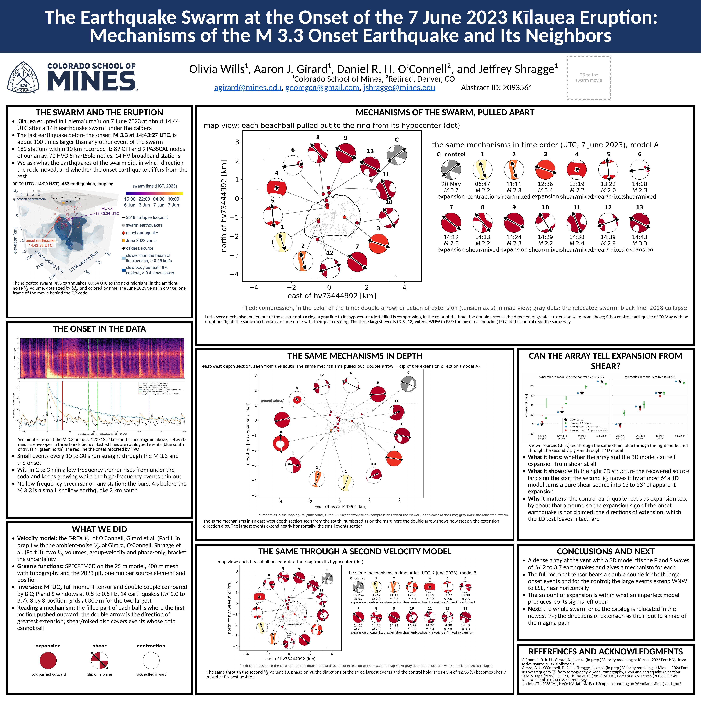
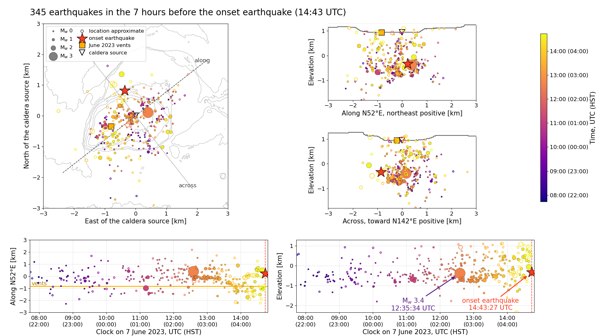

**Olivia Wills**^1^, **Aaron J. Girard**^1^, Daniel R. H. O'Connell^2^ and Jeffrey Shragge^1^\
^1^Colorado School of Mines, ^2^Retired, Denver, CO

AGU Fall Meeting 2026 · Abstract 2093561

[Download the poster (PDF, 3 MB; draft of 9 November 2026)](files/agu26_kilaueaMTUQ/Girard_AGU26_Kilauea_poster.pdf){.btn .btn-primary}

[{fig-alt="AGU26 Kīlauea poster"}](files/agu26_kilaueaMTUQ/poster_web.jpg)

## The swarm in motion

The relocated earthquakes of 7 June 2023 in the ambient-noise S-wave velocity volume under the summit, one minute of swarm per frame, from 00:32 UTC to midnight. Dots are sized by moment magnitude and colored by time; open circles are approximate locations; the June 2023 vents are the orange square. The eruption begins at about 14:44 UTC, right after the M 3.3.

```{=html}
<video src="files/agu26_kilaueaMTUQ/swarm_mw.mp4" autoplay loop muted playsinline controls style="width: 100%; max-width: 820px;"></video>
```

The same movie with the 13 earthquakes that have a 3D moment tensor drawn as beachball spheres: the filled part is where the first motion pushed outward, in the color of the time.

```{=html}
<video src="files/agu26_kilaueaMTUQ/swarm_beachballs.mp4" autoplay loop muted playsinline controls style="width: 100%; max-width: 820px;"></video>
```

The seven hours before the onset earthquake within 3 km of the caldera source, a sliding one-hour window: map, sections along and across the N52E trend of the cluster, and position against time.

```{=html}
<video src="files/agu26_kilaueaMTUQ/preonset_window.mp4" autoplay loop muted playsinline controls style="width: 100%; max-width: 820px;"></video>
```

[{fig-alt="Pre-onset views"}](files/agu26_kilaueaMTUQ/preonset_views.png)

## Overview

*To come.*

::: {.callout-note collapse="true" appearance="minimal"}
## Abstract, as accepted

**Moment Tensor Analysis of an Mw 3.5 Earthquake Preceding the June 7, 2023 Kīlauea Eruption**

*The abstract was written before the relocation and the 3D inversions; the onset earthquake is M 3.3 in the USGS catalog, and the poster uses that magnitude.*

Moment tensor inversions have previously been used to classify earthquakes at Kīlauea Volcano, Hawaiʻi, but sparse coverage of permanent Hawaiian Volcano Observatory (HVO) stations has limited the resolution of source type and geometry. Here, we take advantage of a dense, temporary seismic array of more than 1800-nodes deployed across the Kīlauea summit region as part of the Kīlauea Seismic Imaging Project to characterize an Mw 3.5 earthquake immediately preceding the June 7, 2023, eruption, an event of particular interest for its potential relationship to pre-eruptive processes. We use the open-source software MTUQ to perform a full moment tensor grid search over source geometry, magnitude, and depth, fitting body-wave-windowed, bandpass-filtered (0.25–2.0 Hz) waveforms from the dense nodal array to 1D Green's functions. The Green's functions are computed for a Kīlauea summit velocity model derived from co-located vibroseis active-source data, with a depth-dependent Vp/Vs ratio and densities from previous studies. Preliminary results indicate a significant non-double-couple component in the best-fitting solution, consistent with an isotropic or compensated linear vector dipole (CLVD) contribution beyond simple shear faulting that may be linked to fluid or gas movement in the shallow summit reservoir preceding eruption. The resolved source type is sensitive to waveform windowing and station subset, underscoring the importance of dense azimuthal coverage and systematic robustness testing for reliably distinguishing genuine source characteristics from processing-dependent artifacts. This work shows that dense nodal arrays paired with open-source tools such as MTUQ enable robustness testing not possible with sparse station coverage alone, providing a template for quantifying source mechanisms and uncertainty in future volcanic seismic monitoring efforts.
:::

## Papers

- **O'Connell, D. R. H., A. J. Girard, et al.** (in prep.), Velocity modeling at Kīlauea 2023 Part I: Vp from active-source tri-axial vibroseis.
- **Girard, A. J., D. R. H. O'Connell, J. Shragge, et al.** (in prep.), Velocity modeling at Kīlauea 2023 Part II: Low-frequency Vs from tomography, eikonal tomography, HVSR and earthquake relocation.
- Thurin, J., et al. (2025), [MTUQ: moment tensor uncertainty quantification](https://github.com/mtuqorg/mtuq).
- Tape, W. and C. Tape (2012), [A geometric setting for moment tensors](https://doi.org/10.1111/j.1365-246X.2012.05491.x), *Geophysical Journal International*, 190, 476–498.

## Contact

Aaron J. Girard, Center for Wave Phenomena, Colorado School of Mines
[agirard@mines.edu](mailto:agirard@mines.edu) · [aaronjgirard.github.io](index.qmd) · [LinkedIn](https://www.linkedin.com/in/aarongirard/)

## Acknowledgments

Nodes from GTI, PASSCAL and the Hawaiian Volcano Observatory; HV broadband data via EarthScope; computing on Wendian (Colorado School of Mines) and gpu2.
